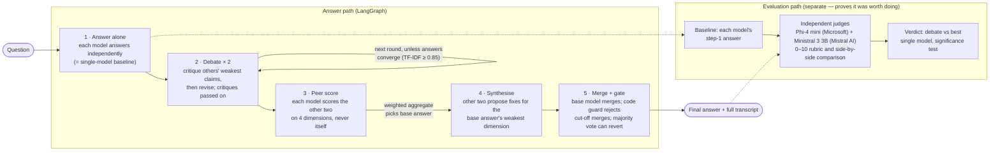

# Multi-Model Debate Agent

A multi-model debate system that takes a question, sends it to 3+ models from 2+ vendors, and returns the best answer through structured debate — not by asking one model to pick.

## The Problem It Solves

Different models answer the same question differently. The best answer may not come from any single model. This system orchestrates a structured debate between models so they **engage with each other's answers**, then produces a synthesized answer that demonstrably outperforms any individual model.

## How It Works

A rendered version of this diagram is in [submission/architecture.pdf](submission/architecture.pdf) (slide 1 of the deck).



| Step | What happens | Who decides |
|---|---|---|
| 1. Answer alone | Llama 3.2 3B (Meta), Qwen 2.5 3B (Alibaba), Gemma 3 4B (Google) answer independently | each model, for itself |
| 2. Debate (≤ 2 rounds) | Each model reads the others' answers and critiques, names their weakest claim, defends or revises its own (critique and revised answer are separated by a `REVISED ANSWER:` marker). Stops early when answers stop changing | each model, for itself |
| 3. Peer score | 6 cross-scores (no self-scoring) on completeness, accuracy, reasoning, nuance; scorers weighted by the quality of their own answer; highest aggregate = base answer | all three models |
| 4. Synthesise | The two non-base models propose fixes targeted at the base answer's weakest dimension | two models |
| 5. Merge + gate | Base model merges (decisions logged, only the text after `FINAL ANSWER:` kept). A code guard rejects a truncated or collapsed merge; then the two other models vote, and a majority can revert to the base answer | code + two models |

### How Each Constraint Is Met

| Constraint | How it's addressed |
|---|---|
| **3+ models, 2+ vendors** | 3 models from 3 vendors (Meta, Alibaba, Google), enforced at start-up. Bedrock config: Anthropic, Meta, Mistral |
| **No single model decides** | Base answer chosen by aggregated peer scores; fixes from two models; merge checked by code and by a majority vote of the other models. No model ever picks or merges alone |
| **Models engage with each other** | Debate rounds require critiquing each other's weakest claims; critiques are forwarded so they can be answered. Full exchange saved as a transcript |
| **Works on open questions** | Rubric scoring and synthesis instead of voting |
| **Prove it was worth doing** | Independent judges (no shared vendor) compare the debate answer with each model's own answer, by 0–10 rubric and side by side; significance tested. The judges are themselves validated first |
| **One command, env keys, spend ceiling** | `python run_debate.py …`; keys only from environment variables; hard `$25` ceiling in `src/models.py` |

### What "Best" Means — and How We Tested It

"Best" = the answer an **independent judge panel** rates highest on four equally weighted dimensions: **completeness, accuracy, reasoning, nuance**. The same rubric drives peer scoring inside the debate.

A metric is only useful if it can tell good from bad, so the judges are tested before their verdict is used (`python run_debate.py validate-judges`): six real answers, one per question category, are each damaged four ways **by code** (cut to 40% → completeness; three false facts → accuracy; sentences shuffled → reasoning; caveats deleted → nuance). A trustworthy judge must rank the original above the damaged copy. Two methods are tested:

- **Absolute** (`--method absolute`): judge scores each answer 0–10 on its own.
- **Pairwise** (`--method pairwise`): judge sees both answers and picks the better, asked twice with positions swapped to cancel position bias.

Results are in `evaluation/judge_validation/` and on slide 2.

**Baselines.** Each model's baseline is its own step-1 answer (written before it saw any other model), so the comparison is like-for-like at no extra cost. The headline compares the debate answer with the **best model overall** (what a firm would deploy today); the stricter comparison is with whichever model scored best on each question.

## Setup

### Free local setup (default — no account, no keys, $0)

`config/config.yaml` runs open-weight models locally through [Ollama](https://ollama.com):

| Role | Model | Vendor |
|---|---|---|
| Debater | Llama 3.2 3B | Meta |
| Debater | Qwen 2.5 3B | Alibaba |
| Debater | Gemma 3 4B | Google |
| Judge | Phi-4 mini | Microsoft |
| Judge | Ministral 3 3B | Mistral AI |

```bash
ollama pull llama3.2:3b && ollama pull qwen2.5:3b && ollama pull gemma3:4b && ollama pull phi4-mini && ollama pull ministral-3:3b
python run_debate.py debate "Your question"        # ~5 min on a 6 GB laptop GPU
python run_debate.py evaluate --questions Q06      # ~10 min: debate + judging
```

Small local models are slower and weaker than hosted frontier models; they demonstrate the mechanism, not peak quality.

### AWS Bedrock setup (Claude Sonnet 4.5, Llama 3.3 70B, Mistral Large)

Set `CONFIG_PATH=config/config.bedrock.yaml` and the credentials below.

### Prerequisites (Bedrock)
- Python 3.10+
- AWS credentials **in environment variables** with Bedrock access to: Claude Sonnet 4.5, Llama 3.3 70B, Mistral Large (debate) and Nova Pro, Command R+ (judges), in `us-east-1`
- (Optional) `OPENAI_API_KEY` for a third judge (GPT-4o)

### Installation

```bash
pip install -r requirements.txt
cp .env.example .env
# Edit .env with your credentials
```

### Configuration

Edit `config/config.yaml` to change models, judges, debate rounds, or scoring weights.

**Keys** are read from environment variables only (`.env` is loaded into the environment if present); there is no `~/.aws` profile fallback.

**Spend ceiling**: `HARD_CEILING_USD = 25.00` in `src/models.py` is the hard cap; `spend_ceiling.max_total_usd` in config (default $20) can only lower it. Every call is priced; the run stops when the ceiling is crossed and the evaluation summarises the questions completed so far.

### Dry run (no keys, no spend)

```bash
python run_debate.py --dry-run debate "Any question"
python run_debate.py --dry-run evaluate
```

Uses offline mock models to exercise the whole pipeline. Output goes to `transcripts_dry_run/` and `evaluation/results_dry_run/` so it never overwrites real results. A PDF built from dry-run results is watermarked.

## Usage

### Run a single debate

```bash
python run_debate.py debate "Should companies be required to disclose when customers are interacting with an AI?"
```

This produces:
- The final debate-synthesized answer (printed to stdout)
- A full debate transcript in `transcripts/debate_transcript.md`
- Machine-readable transcript in `transcripts/debate_transcript.json`

### 1. Validate the judges (run first)

```bash
python run_debate.py validate-judges --method absolute   # judges score each answer 0-10 alone
python run_debate.py validate-judges --method pairwise   # judges pick the better of two, both orders
```

Six real answers (one per category) are damaged four ways by code; the judges must rank the original above the damaged copy. Output: `evaluation/judge_validation/summary_<method>.json`. Pass bar: 80%.

### 2. Run the evaluation

```bash
# Pilot: one question per category (~1 h locally)
python run_debate.py evaluate --questions Q01,Q06,Q11,Q16,Q21,Q26

# Full set: 30 questions (~4-5 h locally, $0)
python run_debate.py evaluate
```

For every question: one debate, then the independent judges compare the debate answer with each model's own step-1 answer, both by 0-10 rubric and side by side. Output in `evaluation/results/`:
- `summary.json`: question count, wins/ties/losses vs the best model, margins, significance (Wilcoxon for scores, sign test for side-by-side), per-category results, measured calls/tokens/time per answer
- `Q<nn>_result.json`: per-question scores and every judge verdict
- `transcripts/Q<nn>.md`: the full debate behind each result

### 3. Build the slides

```bash
python generate_pdf.py   # → submission/presentation.pdf (6 slides) + submission/architecture.pdf
```

Every number on the slides is read from the result files, so the deck always matches the latest run.

## Project Structure

```
multi-model-debate-agent/
├── config/
│   ├── config.yaml            # Default: free local models via Ollama (debaters, judges, limits)
│   └── config.bedrock.yaml    # Alternative: AWS Bedrock (CONFIG_PATH=config/config.bedrock.yaml)
├── evaluation/
│   ├── questions.json         # 30 open-ended questions, 6 categories x 5
│   ├── judge_validation/      # Judge validation results (absolute and pairwise)
│   └── results/               # Evaluation output + per-question transcripts
├── src/
│   ├── connections.py         # Config loading; AWS Bedrock client (env-var keys only)
│   ├── models.py              # Model layer: Ollama / Bedrock / OpenAI / mock, spend ceiling, usage
│   ├── debate_state.py        # TypedDict state definition
│   ├── debate_nodes.py        # LangGraph node implementations
│   ├── debate_graph.py        # LangGraph pipeline orchestration
│   ├── prompts.py             # All prompt templates
│   ├── transcript.py          # JSON + Markdown transcript generation
│   ├── evaluation.py          # Evaluation: rubric + side-by-side judging, significance tests
│   └── judge_validation.py    # Tests that the judges detect deliberately damaged answers
├── submission/                # presentation.pdf (6 slides) + architecture.pdf
├── transcripts/               # Output of `debate` (single question)
├── generate_pdf.py            # Builds the deck from the result files
├── run_debate.py              # CLI: debate | evaluate | validate-judges
├── requirements.txt
└── README.md
```

## Research Background

Based on ["Improving Factuality and Reasoning in Language Models through Multiagent Debate"](https://composable-models.github.io/llm_debate/) (Du et al., ICML 2024):

- Multiple LLM instances debate over rounds, naturally converging to better answers
- Cross-model debate (different models) can solve problems neither model solves alone
- 3 agents × 2 rounds is the empirically optimal cost/quality tradeoff

**Our extension beyond the paper**: The paper tests on factual/math benchmarks with ground truth. We handle **open-ended questions** where there is no single correct answer — this requires dimensional scoring instead of voting, and collaborative synthesis instead of convergence checking.

## Alternative Approaches Considered

We evaluated several multi-model consensus strategies before choosing structured debate. Here's why:

| Approach | How It Works | Why We Didn't Use It |
|----------|-------------|---------------------|
| **Mixture of Agents (MoA)** ([Wang et al., 2024](https://arxiv.org/abs/2406.04692)) | Layer models: layer N reads all layer N-1 outputs and produces a refined answer. A single aggregator at the top produces the final output. | The final aggregator is a single model deciding — violates constraint #1. Also, no genuine back-and-forth engagement between models. |
| **LLM Cascading** ([Chen et al., 2023](https://arxiv.org/abs/2305.05176)) | Route easy questions to weaker models, hard ones to stronger models. | Optimizes cost, not quality. Does not combine knowledge from multiple models — only one model answers each question. |
| **Society of Mind** ([Du et al., 2023](https://arxiv.org/abs/2305.14325)) | Multiple agents discuss in rounds, then a single summarizer produces the final answer. | The summarizer is a single model deciding, violating constraint #1. The discussion format is close to debate but lacks structured scoring. |
| **Best-of-N Sampling** | Generate N answers from one or more models, score them, pick the best. | No engagement between answers — models never see or respond to each other. Works for factual questions with verifiable answers, not open-ended ones. |
| **Voting / Majority Consensus** | Models answer, then vote on the best answer. | The problem statement explicitly rules this out: "Voting works on multiple choice; it does not work on a paragraph." |
| **Ensemble Averaging** | Combine model outputs numerically (e.g., average logits or embeddings). | Only works for classification/numeric tasks. Cannot meaningfully average free-text paragraphs. |

### Why Structured Debate Wins for This Problem

1. **Models genuinely engage**: Each model reads others' answers, critiques them, and revises its own. This is the only approach where models respond to specific points in each other's reasoning.
2. **No single model decides**: Peer scoring is fully distributed — every model scores every other model. The base answer is selected by aggregate vote, and non-base models contribute improvements. The final merge is done by a collectively-chosen model following others' instructions.
3. **Works on open-ended questions**: Dimensional scoring (completeness, accuracy, reasoning, nuance) replaces binary voting. Synthesis adds missing points rather than picking a winner.
4. **Proven foundation**: Du et al. demonstrated that debate improves factual accuracy. We extend to open-ended domains with structured scoring.

### Potential Improvements

- **Hybrid MoA + Debate**: Use debate for engagement, then MoA-style layering for synthesis — could capture benefits of both.
- **Adaptive rounds**: Stop debate early if answers converge (measure similarity between rounds), saving tokens.
- **Weighted peer scoring**: Weight each model's scoring ability by historical calibration instead of equal weighting.
- **Diverse judge panel**: Use models from vendors not involved in the debate as judges to eliminate any bias.
